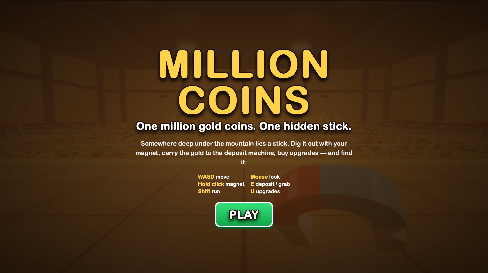

# Million Coins

**One million gold coins. One hidden stick. One mission: find it.**

Million Coins is an experimental first-person 3D browser game built with vanilla HTML, CSS, JavaScript, and WebGL2. Explore a massive underground treasure vault, collect gold coins using a magnetic tool, deposit your loot, purchase equipment upgrades, and dig your way toward the hidden wooden stick.

A lightweight, zero-dependency gaming experience featuring procedural 3D environments, custom WebGL2 rendering, dynamic coin interactions, and responsive controls.

[Overview](#overview) | [Features](#features) | [Preview](#preview) | [Tech Stack](#tech-stack) | [Quick Start](#quick-start) | [Structure](#project-structure) | [Development](#development) | [License](#license)

## Overview

**Million Coins** is a first-person treasure-hunting game built around a simple but challenging objective: find a hidden wooden stick buried beneath a mountain of one million gold coins.

Players explore a large underground vault using a magnetic collection tool to attract nearby coins. Collected treasure can be transported to a deposit machine and exchanged for cash, which can then be used to purchase equipment upgrades.

The game combines custom WebGL2 rendering, procedural geometry, real-time interactions, and a lightweight browser-based architecture.

Instead of simulating one million individual physical objects, the treasure pile uses a granular heightfield and instanced procedural coin rendering to maintain a more efficient rendering pipeline.

With no external frameworks, npm packages, or build system required, Million Coins provides a self-contained browser gaming experience.

## Features

- **First-Person 3D Gameplay** — Explore a detailed underground vault through an immersive first-person perspective.
- **One Million Gold Coins** — A massive procedural treasure environment featuring a granular coin pile.
- **Magnetic Collection System** — Attract nearby coins using a magnetic tool and collect your treasure.
- **Dynamic Coin Interactions** — Coins can move dynamically and fly toward the magnetic collection tool.
- **Deposit & Economy System** — Transport collected coins to the deposit machine and convert your loot into cash.
- **Equipment Upgrades** — Improve magnet performance, bag capacity, and battery capacity using earned money.
- **Hidden Treasure Objective** — Dig through the mountain of gold to discover the hidden wooden stick and complete the challenge.
- **Procedural 3D Environment** — Custom geometry, generated textures, lighting, and rendering created directly through JavaScript and WebGL2.
- **Real-Time HUD** — Displays money, remaining coins, depth, bag capacity, and battery status.
- **Desktop Controls** — Keyboard and mouse support for movement, camera rotation, interaction, and collection.
- **Mobile Touch Controls** — Virtual joystick, touch-based camera movement, and dedicated interaction buttons.
- **Zero Dependencies** — Built entirely with vanilla HTML, CSS, and JavaScript without external frameworks or npm packages.
- **WebGL2 Rendering** — Custom graphics pipeline designed for efficient rendering of a large number of procedural objects.

## Preview
<p align="center">
  
  
</p>

**Live Demo:** https://nowii-core.github.io/million-coins/millioncoins/


## Tech Stack

| Technology | Purpose |
| :--- | :--- |
| **HTML5** | Game structure, interface, and canvas rendering surface |
| **CSS3** | Responsive interface, HUD, menus, and touch controls |
| **JavaScript (ES6+)** | Game engine, gameplay logic, procedural generation, and interactions |
| **WebGL2** | Custom 3D rendering pipeline, shaders, and GPU-accelerated graphics |
| **Canvas API** | Procedural texture generation and image processing |

**Dependencies:** None required.

**Rendering:** WebGL2 is required to run the game.

## Quick Start

### Requirements

- A modern browser with WebGL2 support.
- Chrome, Safari, Firefox, or Edge.
- Keyboard and mouse for desktop gameplay.
- A touchscreen device for mobile controls.
- Visual Studio Code or another code editor for local development.

### Run Locally

1. **Clone the repository**

   ```bash
   git clone https://github.com/nowii-core/million-coins.git
   ```

2. **Enter the project directory**

   ```bash
   cd million-coins/millioncoins
   ```

3. **Open the project**

   ```bash
   code .
   ```

4. **Start the application**

   Open `index.html` using the Live Server extension in Visual Studio Code, or serve the folder using a local development server.

   Alternatively, run:

   ```bash
   python3 -m http.server 8000
   ```

   Then open:

   ```text
   http://localhost:8000
   ```

No installation, package manager, compilation, or build process is required.

## Controls

| Action | Desktop | Mobile |
| :--- | :--- | :--- |
| Move | WASD / Arrow Keys | Virtual joystick |
| Look around | Mouse | Touch and drag |
| Collect coins | Hold left click | MAGNET button |
| Deposit / interact | E | E button |
| Run | Shift | — |
| Open upgrades | U | Upgrade menu |
| Pause | Esc | Pause button |

## Project Structure

```text
million-coins/
└── millioncoins/
    ├── index.html       # Main game structure
    ├── style.css        # Interface, HUD, and responsive styling
    ├── script.js        # Game engine and gameplay logic
    ├── README.md        # Project documentation
    └── LICENSE          # MIT License
```

## Performance & Rendering

Million Coins uses a custom WebGL2 rendering pipeline to handle its large procedural environment.

The treasure pile is represented through a granular heightfield with thermal erosion, combined with approximately 40,000 instanced procedural coin representations.

Additional dynamic coins are used for interactive magnetic collection, while procedural geometry and textures are generated directly through JavaScript.

This approach avoids individually simulating all one million coins while maintaining the visual scale of the environment.

## Development

Million Coins is designed to be straightforward to explore, modify, and extend.

### Recommended Workflow

1. Clone the repository.
2. Open the `millioncoins` folder in your preferred editor.
3. Start a local development server.
4. Modify the HTML, CSS, or JavaScript files.
5. Refresh the browser to test changes.
6. Verify rendering and controls on desktop and mobile devices.

### Customization

The separated project architecture makes individual components easier to maintain:

- **Interface & Structure:** Modify `index.html` to adjust menus, HUD elements, and interface components.
- **Visual Styling:** Edit `style.css` to customize colors, layouts, typography, and responsive elements.
- **Game Engine:** Modify `script.js` to experiment with gameplay mechanics, world generation, coin interactions, and rendering behavior.

## Compatibility

Million Coins requires a browser with WebGL2 support.

Desktop and touchscreen input methods are supported, although performance may vary depending on the device's graphics hardware and browser implementation.

## License

This project is licensed under the **MIT License**. See the [LICENSE](LICENSE) file for details.

## Contact & Support

- **Maintainer:** [@nowii-core](https://github.com/nowii-core)
- **Repository:** [nowii-core/million-coins](https://github.com/nowii-core/million-coins)
- **Issues & Feature Requests:** [Submit an Issue](https://github.com/nowii-core/million-coins/issues)

---

<div align="center">
  <sub>Designed and developed by <b>nowii-core</b></sub>
</div>
